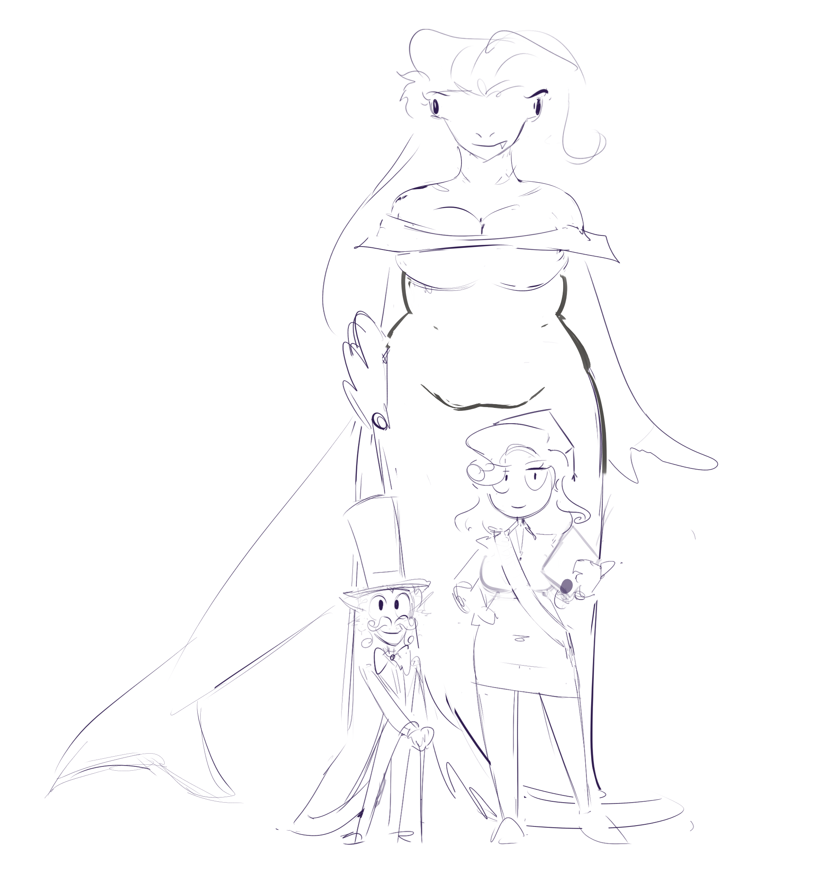

## Основная информация

Глория де Кальмар - действующий СЕО Отдела Кадров ШансКорпа. В сферу её ответственности входят найм, увольнение и дисциплинарные взыскания с сотрудников, решение рабочих и внерабочих конфликтов. Использует служебное положение для собственной выгоды (часто не денежной, а для решения проблем своих и своего близкого круга) и не видит в этом ничего зазорного, ведь если она дослужилась до этой высокой позиции, значит, ей можно использовать все сопутствующие привелегии. Мечтает взабраться ещё выше, хотя бы до роли Генерального СЕО, а в идеале — до обладания контрольным пакетом акций и стать единоличным правителем ШансКорпа.

## Происхождение и детство

Глория родилась как будто всем назло: её родители, Марина Катадонте и Люсьен де Кальмар, происходят из двух враждующих фамилий, потому их союзу противились все родственники, а из-за сильной разницы в размерах у них долгое время были проблемы с зачатием. Неудивительно, что когда Глория всё-таки появилась на свет, её с первого дня жизни любили и оберегали от всего, обычно — от последствий собственных действий.

Уверенность Глории в том, что она лучшая во всём, была заложена ещё с детства. Амбициозная от природы, она везде хотела занимать первые места и никогда не ошибаться, и чтобы она не расстраивалась, родители (в частности отец) делали всё для сохранения этой иллюзии.

## Отношения

У Глории сложные отношения с её коллегой, Айвью. Поначалу Глория не испытывала к ней ничего, кроме презрения, считая её слабохарактерной подлизой, не приспособенной к реальной конкурентной борьбе, получившей своё место зазря. Однако, когда Ай раскрылась с другой стороны — как расчётливая, злопамятная, нахальная, *завистливая* хищница — мнение Глории сразу начало меняться в лучшую сторону. Она решила сделать своей миссией научить Айвью не стесняться своих амбиций и брать то, что хочешь, потому что это главное качество в человеке. В процессе их сближения Глория поймала себя на том, что впервые в жизни у неё появляются к кому-то чувства.

Звездун для Глории что-то вроде протеже. Кто-то может сказать, что она види в нём сына, которого у неё никогда не было.
